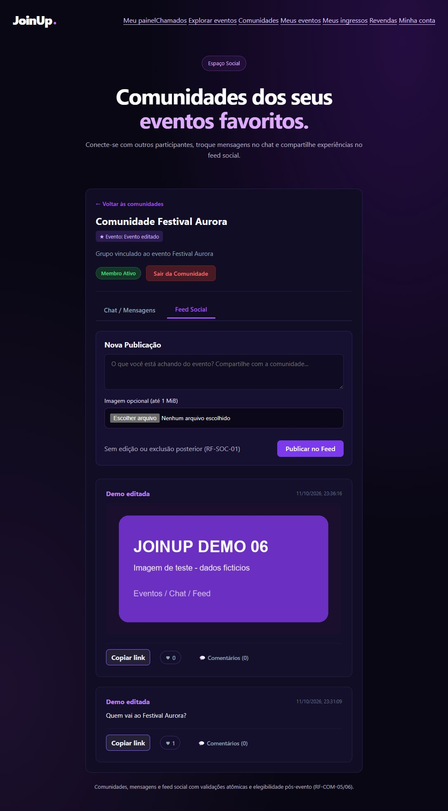

# Entrega 06 — mídia segura e demo automática

Execução: 11–12/10/2026 (America/Sao_Paulo). Base `main` atualizada `2f7c53e` após
PR #7; branch `feat/06-midia-demo`. **PR deve aguardar auditoria técnica;
nenhum merge autorizado ou executado.**

## Escopo entregue

SOC-06: upload de evento futuro pelo organizador dono; posts e mensagens com
texto e/ou imagem; post somente-imagem; leitura comunitária privada revalidada.
BD-02: seed empacotado automático, opt-in exclusivamente local, transacional,
idempotente e sem sobrescrever dados em reinicialização.

Arquitetura permanece Java 21 puro, HttpServer JDK, JDBC/MySQL, Jackson/Maven.
Singleton de configuração, Factory Method de cadastro, Template Method de login
e Facade transacional de eventos permanecem nos mesmos fluxos reais. Nenhuma
classe GoF decorativa, framework web, ORM, pagamento, push/email ou avatar novo.
`schema_v0.2.sql`, `seed_demo_v0.2.sql` e todos os arquivos dos 397 testes
anteriores permanecem sem alterações.

## Arquivos e decisões

- `arquivos/MultipartImagem`, `ImagemSegura`, `ArmazenamentoLocal`,
  `ArquivoService`, `ArquivoRoutes`: contrato binário estrito, normalização,
  arquivos privados, proprietário/contexto/vínculo e autorização.
- `demo/SqlDemo`, `DemoRunner`: lexer de script confiável e carga guardada.
  Só USE exato já validado e INSERT IGNORE das tabelas conhecidas do recurso
  empacotado. Nada de SQL do cliente, SOURCE, DDL/GRANT ou reset automático.
- Configuração imutável: JOINUP_ENV, JOINUP_UPLOAD_DIR e JOINUP_DEMO ativado;
  bootstrap carrega demo antes de alocar servidor/executor, preservando default
  false e o health sem conexão. Com true, erro na carga impede iniciar HTTP.
- Migração separada `migration_06_midia_demo.sql`: duas tabelas aditivas,
  `arquivos` com seis FKs, constraints de dono/contexto/tamanho, vínculo único;
  `demo_execucao` identifica base inicializada por este runner.
- Router escolhe limite pelo método/rota antes da leitura. POST arquivos recebe
  até 1.064.960 bytes; JSON continua 65.536. Normalização limita entrada/saída
  a 1 MiB, 4096 px/dimensão e 4 milhões de pixels. Decoder ImageIO WebP
  TwelveMonkeys 3.12.0 adicionado para validar o terceiro formato em Java puro.
- Social mantém locks conta/sessão → evento → ingressos → filiação → arquivo.
  Vínculo e INSERT social são uma transação; perda de autorização é revalidada.
  Post/chat vazio em ambos os campos permanece inválido. Sem editar/excluir posts.
- Eventos preservam imagem persistida quando omitida em PATCH. JSON não aceita
  referências de outro evento. Descoberta pública usa imagem atual do evento,
  evitando thumbnail quebrada depois de substituição/limpeza.
- `midia.js/css`, eventos e comunidades: upload/preview/erro, botões bloqueados
  durante envio, imagem local autorizada e texto escapado. CSP libera blob:
  apenas para prévia de imagem. Nada de token em JS/localStorage ou retry POST.

Contrato detalhado: [ARQUIVOS_HTTP_06.md](../api/ARQUIVOS_HTTP_06.md).
README corrigido para `main` pós-PR #7 e execução nova com schema/migração
administrativos, conta DML e contas exclusivamente de fixture.

## Demo e idempotência

JOINUP_DEMO=false retorna antes de conectar/ler seed. true exige JOINUP_ENV=demo,
JDBC em loopback, servidor HTTP 127.0.0.1 e origem local. Configuração JDBC já
restringe o banco a joinup_poo; runner confere DATABASE(), schema e migração.
Não acessa legacy joinup. Base populada sem marcador é recusada, inclusive
seed antigo aplicado manualmente; não tenta inferir ambiente pelo e-mail.

Primeiro início exige as 23 tabelas de domínio/mídia vazias; GET_LOCK serializa
bootstraps. Seed original e marcador confirmam juntos. Warnings de INSERT
IGNORE na carga inicial são erros, para não esconder FK/truncamento. Reinício
com marcador seed_v0.2 não reaplica o script: preserva todas as linhas/colunas,
datas, hashes, nomes alterados, inativos e dados removidos. Não restaura seed.
Migração/schema são executados somente pela administração, nunca pela conta DML.

## Execução local e regressão

Windows, Eclipse Temurin 21.0.12.1, Maven 3.9.9 e MySQL Community **8.4.0** real.
Binários oficiais locais já existentes em `%LOCALAPPDATA%/JoinUp-POO/tools`.
Regressão usa instância isolada em 3307. Seed automático usa uma segunda
instância nova em 3309, sempre banco joinup_poo; navegador usa terceira
instância de demonstração em 3308, sem disputar fixtures da regressão.
Conta HTTP/testes joinup_it exclusivamente DML nas duas instâncias (administração
revoga o ALL inicial que MYSQL_USER recebe no container oficial); root local apenas fixtures e
triggers. Credenciais desses ambientes são descartáveis e não de produção.

Comando completo executado:

```powershell
mvn --batch-mode --no-transfer-progress -Pmysql-it clean verify
```

Resultado local: **BUILD SUCCESS, 468 testes, 0 falhas/erros/ignorados**.
167 Surefire + 301 Failsafe, concluído às 23:36:31 de 11/10/2026, 2min36s.
Após refinamento de imagem pública atual e chat somente-imagem, foi reexecutada
a suíte focada `-Pmysql-it -Dit.test=ZArquivosMySqlIT verify`: 167 Surefire +
45 mídia, verde. CI completo do código final será registrado abaixo.

| Suíte | Testes | Resultado local |
| --- | ---: | --- |
| Surefire anterior | 149 | Preservados, verde |
| ImagemSeguraTest + SqlDemoTest | 18 | Verde |
| MySqlIntegrationIT | 46 | Verde |
| ComercioMySqlIT | 63 | Verde |
| ComunidadeMySqlIT | 65 | Verde |
| SuporteMySqlIT | 63 | Verde |
| PaineisMySqlIT | 11 | Verde |
| ZArquivosMySqlIT | 45 | Verde |
| ZDemoMySqlIT | 8 | Verde |
| **Total** | **468** | **Zero falhas/erros/ignorados** |

As 397 verificações originais não foram excluídas, renomeadas ou relaxadas.
Failsafe passa a ordenar classes alfabeticamente: a regressão original valida
22 tabelas antes da suíte mídia aplicar duas tabelas aditivas e retirá-las ao
terminar. Só remove objetos criados pela própria suíte, sem DROP DATABASE,
TRUNCATE ou FOREIGN_KEY_CHECKS=0. A segunda instância demo começa vazia e nunca
é apagada pela suíte. Novo diretório de arquivos IT é explicitamente configurado
e deve começar vazio. CI provisiona dois serviços mysql:8.4.0 independentes.

Cobertura nova: PNG/JPEG/WebP reais, normalização de payload anexado, dimensões,
multipart binário, MIME/bytes/nome/headers suspeitos, JSON 64 KiB, upload com
Content-Length/chunked, CSRF, sessão, perfil, IDOR, membro/ingresso, pós-evento,
pending de outro dono/comunidade/contexto, uso único/expiração, digest corrompido,
arquivo faltante, CREATE_NEW/NOFOLLOW, DML sem DDL, rollback/limpeza SQL e falha
de diretório. Quatro interleavings HTTP reais de upload/vínculo x revenda do
último ingresso observam duas esperas em performance_schema.data_lock_waits;
venda antes da mídia nega 403 e mantém histórico/filiação coerentes. Há também
perda de elegibilidade sob lock durante upload e revenda concluída invalidando
leitura e pending; compras/revenda não foram reimplementadas.

Demo: bootstrap em processos JVM novos, false mesmo com JDBC inacessível,
base alheia recusada, trigger durante seed com rollback integral, dois inícios
com snapshot de todas as colunas idêntico, preservação de nome/senha/inativo/
evento editado/comentário removido, perfil production/local recusado, login
HTTP real dos três perfis e CREATE/ALTER negados à conta DML.

Tentativas intermediárias registradas: expectativa de FKs no teste corrigida
de sete para seis; teste de revenda corrigido para enviar `{}` conforme contrato
existente. Um clean local foi recusado pelo Windows porque o JAR estava aberto
no processo do navegador; a sanidade passou a usar cópia fora de target.
Teste adicional de excesso declarado de corpo inicialmente revelou TCP reset
quando o cliente Java continuava escrevendo após 413; uma tentativa inicial
de teste apenas por headers passou, mas não cobriu o corpo JSON marginalmente
acima de 64 KiB. Os runs documentais finais
[38197866695](https://github.com/ericjs-code/JoinUp-POO/actions/runs/38197866695) e
[38197863736](https://github.com/ericjs-code/JoinUp-POO/actions/runs/38197863736)
falharam nesse caso de transporte (00:02 de 12/10/2026), com 467 casos verdes
e um erro de conexão. A correção em RequestBody mantém a leitura estritamente
limitada a limite+1 mesmo quando Content-Length indica excesso; evita fechar
com >64 KiB pendentes no caso marginal, sem ampliar JSON/upload nem drenar
indefinidamente. Teste voltou a enviar o corpo multipart completo com/sem
Content-Length e repete o JSON excessivo cinco vezes, seguido de GET válido.
Não foi removido nem relaxado o teste de HTTP 413.
Shade mantém warnings usuais de manifests/licenças/module-info; BUILD SUCCESS.

## Sanidade de navegador realizada

Navegador integrado do Codex, JAR compilado, HTTP e MySQL 8.4 real, conta DML.
Fixture PNG 640×360 gerada localmente, sem imagem/dado pessoal. Não foi usada
massa do PHP. Referência PHP local foi consultada só para campos/evento/social/chat.

1. Ana: login, comunidade Aurora, prévia de PNG, post **sem texto**, publicação
   exibida com naturalWidth=640/naturalHeight=360. Chat com imagem e literal
   `<script>teste escapado</script>` mostrado como texto; imagem carregada.
2. Aurora: login, gestão de evento próprio futuro, upload, imagem atual e
   catálogo renderizados em 640×360. Categorias já vendidas continuam bloqueadas.
3. Suporte Um: login e painel real com três chamados e distribuição de estados.
4. Logout: imagem pública de evento continua carregando; comunidade mostra
   Visitante e bloqueia feed/chat. Navegação direta à imagem privada foi bloqueada
   pelo navegador integrado (`ERR_BLOCKED_BY_CLIENT`); o status HTTP 401 e demais
   negações são comprovados pela suíte HTTP, sem atribuí-los à captura de UI.

Capturas em evidencias/: `entrega_06_post_imagem.jpg`, `entrega_06_chat_imagem.jpg`,
`entrega_06_organizador.jpg`, `entrega_06_catalogo_publico.jpg`,
`entrega_06_suporte.jpg`, `entrega_06_visitante.jpg`. Sem erros de console
observados no roteiro. Uma interação durante carregamento acionou saída da
comunidade; filiação foi restabelecida pela UI antes da publicação. Capturas
representam sanidade desktop, não homologação móvel/leitor de tela/end-to-end
de toda a plataforma. Mensagem somente-imagem foi verificada via HTTP/MySQL;
a captura de chat inclui texto + imagem.

## CI remoto e gate

**Primeira revisão confirmada completed/success** no código `fe66b03aa5cdca035fc35845222bb33421e66384`:

- [CI do PR, run 38197405445](https://github.com/ericjs-code/JoinUp-POO/actions/runs/38197405445),
  job 114643047450: **468 testes**, 167 Surefire + 301 Failsafe; zero falhas/erros/
  ignorados. BUILD SUCCESS às **23:55:06 de 11/10/2026** (America/Sao_Paulo),
  duração Maven 3min27s. Totais conferidos nos logs efetivos do job.
- [CI do push, run 38197403293](https://github.com/ericjs-code/JoinUp-POO/actions/runs/38197403293),
  job 114643040203: completed/success no mesmo SHA.
- Java 21, dois serviços **mysql:8.4.0**, comando integral
  `mvn --batch-mode --no-transfer-progress -Pmysql-it clean verify`.
- [Extrato dos logs conferidos](evidencias/entrega_06_ci.txt) e
  [evidência local](evidencias/entrega_06_local.txt). Relatórios Surefire/Failsafe
  e inventário MySQL publicados como artefato pelo workflow. Symlink real Linux
  foi exercitado no teste, além do fallback de diretório não regular no Windows.

[PR #8](https://github.com/ericjs-code/JoinUp-POO/pull/8) permanece aberto, sem
merge. A consulta de reviews retornou lista vazia; auditoria técnica do Tech Lead
continua pendente. A reexecução documental revelou a condição de transporte descrita acima;
a correção limitada de RequestBody está em nova validação completa. Os runs
verdes anteriores permanecem evidências históricas, sem substituir o gate do
código corrigido. A evidência final será acrescentada à descrição do PR e
conferida antes de devolver a entrega.

## Limites e pendências explícitas

- Auditoria técnica externa e aceite do Tech Lead pendentes. PR aberto, sem merge.
- Reconciliação filesystem/InnoDB após crash/energia ou commit indeterminado,
  limpeza de pending abandonado e arquivos de eventos substituídos são tarefas
  administrativas offline. Limite de 24h impede uso de pending expirado, sem
  prometer coletor automático. Erros SQL normais e falhas físicas foram testados.
- Diretório deve ser exclusivo e protegido pelo SO. Windows local não permitiu
  criar symlink no teste; fallback testou arquivo/diretório não regular. CI Linux
  exercitou symlink real; não afirmar privilégio Windows que não foi concedido.
- Sem rate limiting/quota total, antivírus, benchmark, CDN/cache público ou
  garantia contra administrador local. Escopo é demonstração acadêmica local.
- Não há campo/avatar de perfil v0.2; mantido fora deste incremento. UI de criação
  de evento usa fluxo em duas etapas (criar pela Facade e enviar pela gestão).
- Consolidação UML/relatório RA2, revisão global dos três perfis, mobile/leitor
  de tela e demais ressalvas da auditoria 05 continuam para a Entrega 07.


